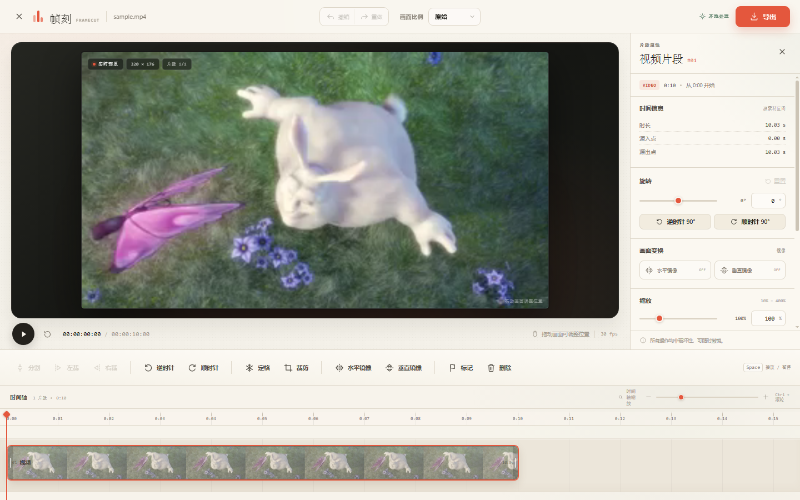
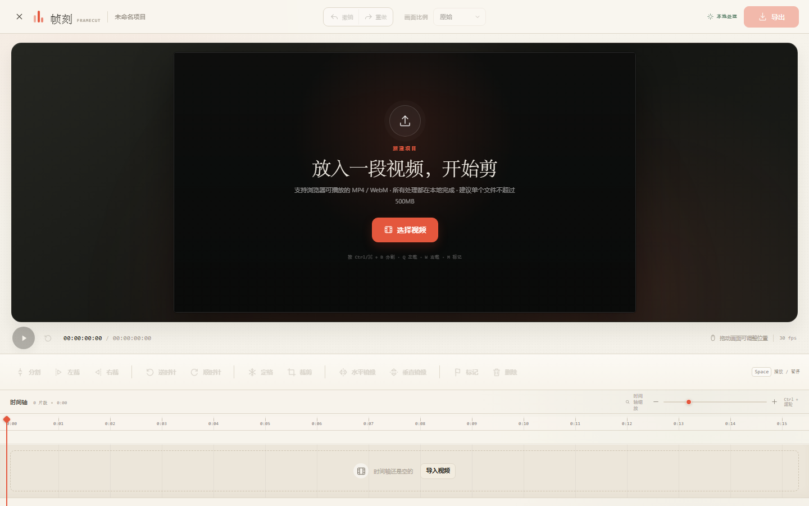
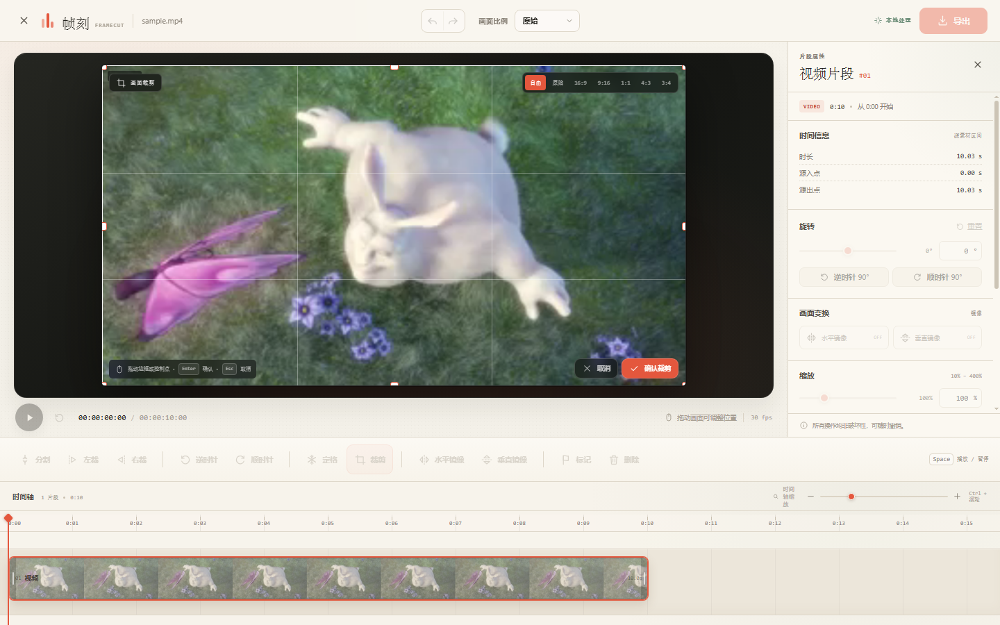
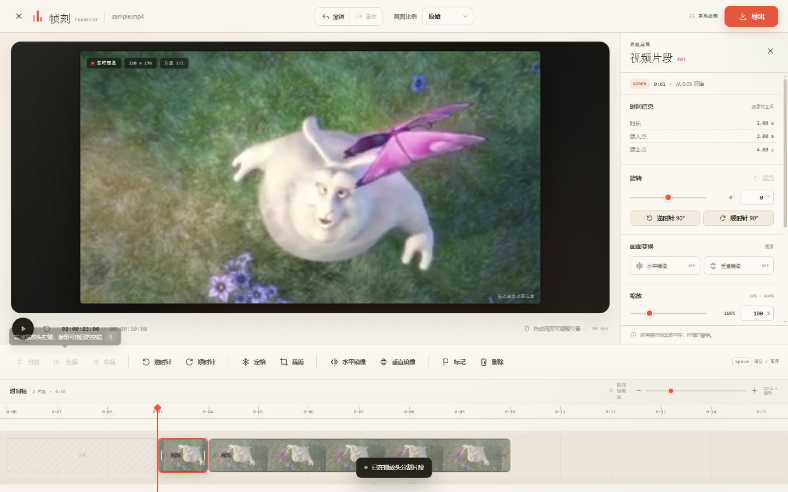
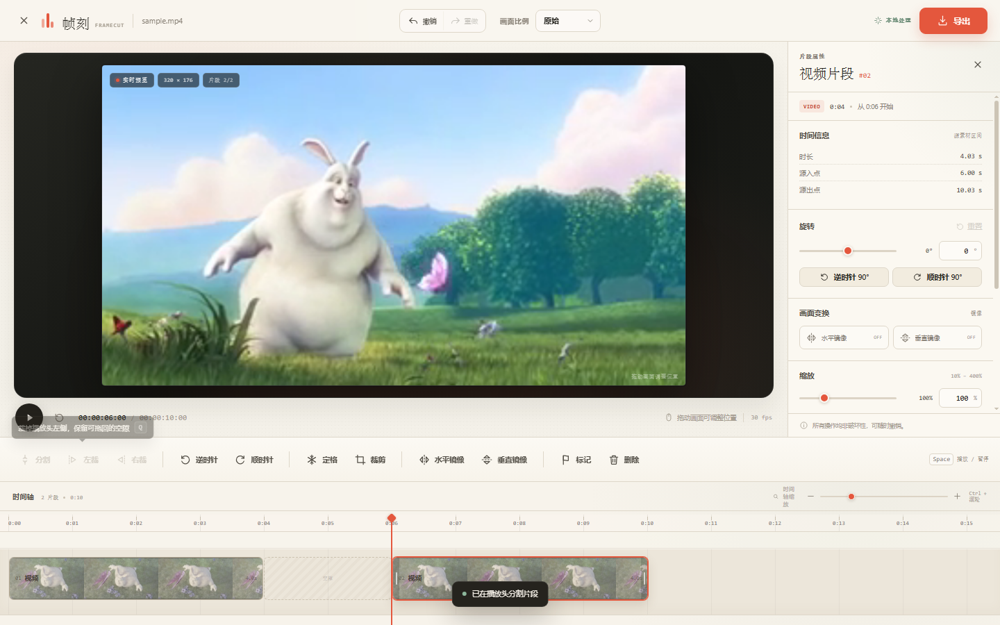
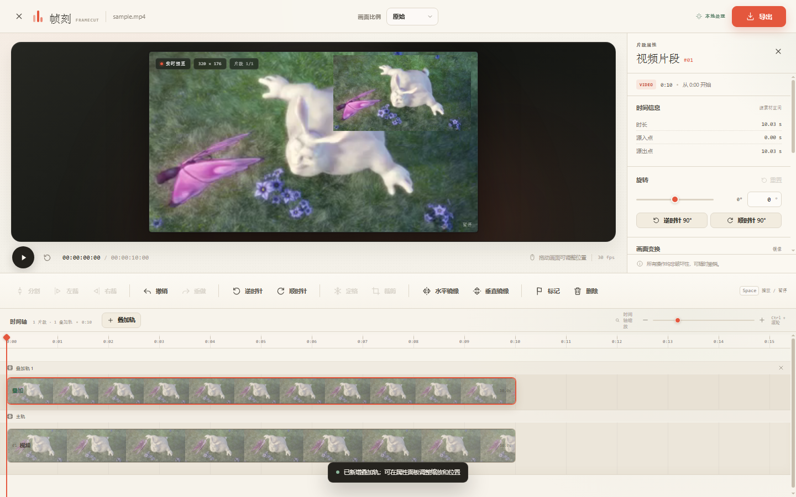
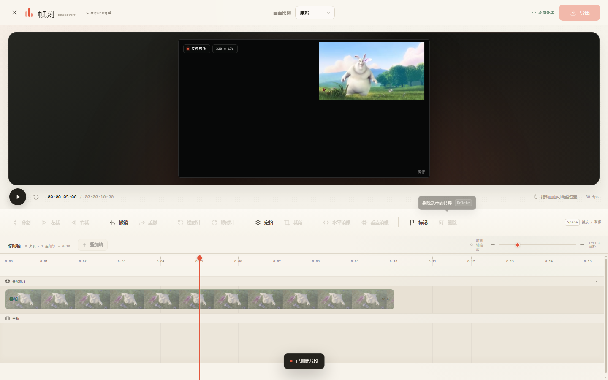
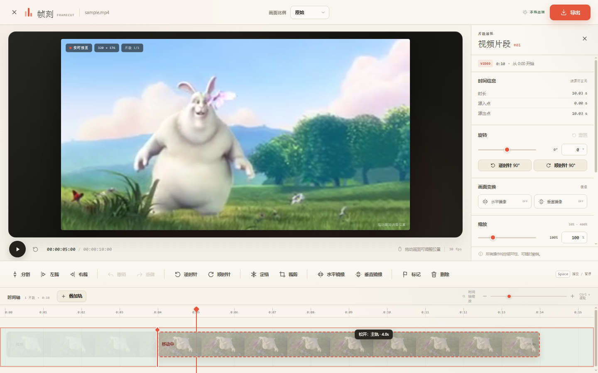
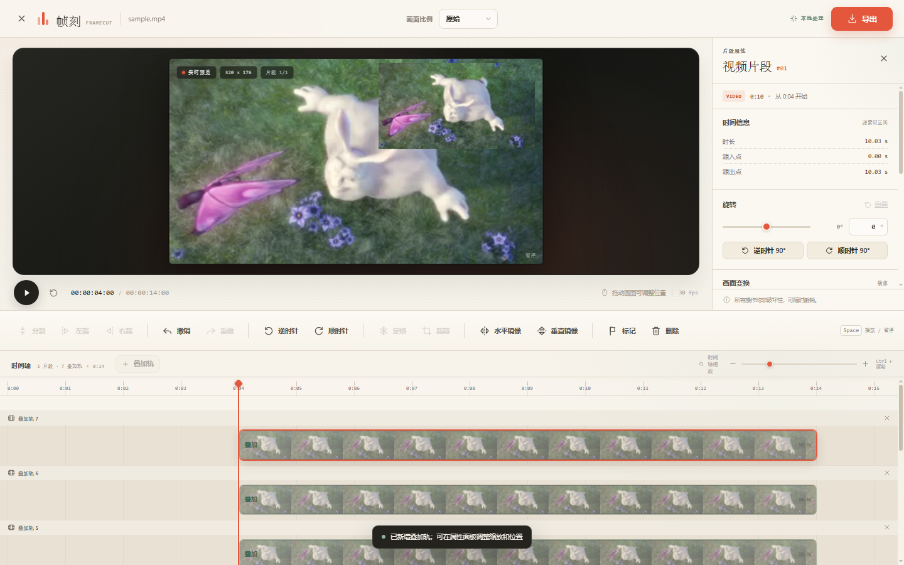
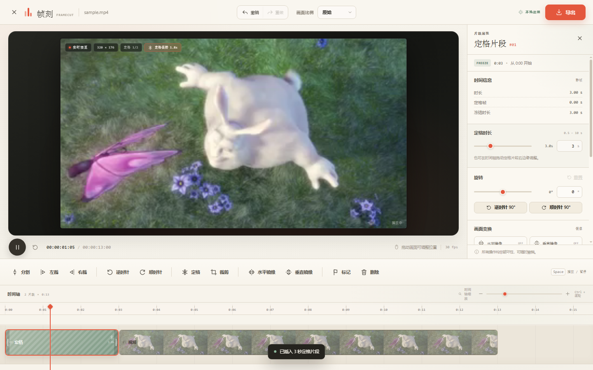

# 帧刻 FrameCut

一个可嵌入宿主平台的轻量在线视频剪辑器。暖纸色 + 朱砂强调色的原创视觉，React 18 + TypeScript + Vite + Zustand，预览用 HTML5 Video 驱动 Canvas，导出用 FFmpeg.wasm 在浏览器本地合成，不依赖后端。



## 目录

- [特性一览](#特性一览)
- [快速开始](#快速开始)
- [1. 项目结构与数据模型](#1-项目结构与数据模型)
- [2. 按步骤实现说明](#2-按步骤实现说明)
- [3. FFmpeg 导出滤镜地图](#3-ffmpeg-导出滤镜地图)
- [4. 测试与验证](#4-测试与验证)
- [5. 边界情况](#5-边界情况)
- [嵌入宿主平台](#嵌入宿主平台)
- [交互与快捷键](#交互与快捷键)
- [已知限制](#已知限制)

## 特性一览

| 能力 | 说明 |
| --- | --- |
| 非破坏性编辑 | 原视频只读；所有操作记录在 JSON 项目数据中，导出时才真正处理 |
| 命令模式历史栈 | 所有项目修改经由 `execute()`，快照式撤销/重做，最多 100 步 |
| 撤销 / 重做 | 工具栏带文字按钮；撤销 `Ctrl/⌘ + Z`，重做 `Shift + Ctrl/⌘ + Z`（即恢复上一次撤销） |
| 多轨视频叠加 | 主轨 + 最多 7 条叠加视频轨（共 8 条视频轨）；每轨可放任意素材；画中画缩放/位置、轨道增删、片段上下轨拖动 |
| 自由定位拖动 | 拖动片段到任意时间/轨道；目标轨高亮、红色时间落线、落点时间提示；实时移动幽灵片段跟随抓取位置 |
| 空叠加轨 | 新增叠加轨不复制素材，直接生成空轨，把主轨/其他轨片段拖入即可 |
| 时间轴开关 | 主轨磁吸（默认关闭）、自动吸附（默认开启）、联动（默认关闭，后续片段随位移平移）、预览轴（默认开启，悬停时间线） |
| 时间轴高度 | 拖动时间轴上沿向上加高、向下压缩；双击手柄恢复默认高度 |
| 叠加预览 | 每条叠加轨独立视频解码（可来自不同素材），按轨道顺序合成到同一 Canvas |
| 叠加导出 | 每个叠加素材独立 `-i` 输入 + FFmpeg `overlay`；主轨保留原声，叠加视频静音 |
| 素材库 | 一次导入多个视频，生成缩略图/时长/分辨率；点击添加到播放头，拖到主轨或叠加轨；HEVC/H.265 等浏览器不支持编码自动转 H.264 代理后导入 |
| 多源导出 | 每个片段按 `sourceUrl` 映射到自己的 FFmpeg 输入；时长、分辨率与音轨独立计算 |
| 音频轨 | 导入 MP3/WAV/M4A 等音频；波形、片段移动/裁剪、轨道音量/静音/隐藏、片段音量与淡入淡出；预览播放并与原声混音导出 |
| 音频检测 | 导出完成页可运行 FFmpeg `volumedetect`，显示峰值/平均 dB；无音轨或 -∞ 可直接判断静音，无需听声音 |
| 文本 / 字幕 | 文本轨：字体、字号、颜色、背景/描边、位置、对齐、粗体；播放头分割/左右裁；SRT/VTT 导入；画面上直接拖动定位；预览与导出 PNG 烧录 |
| 智能字幕 | 本地 Whisper（Transformers.js v3，small/medium 词级时间戳）；按素材识别并 IndexedDB 缓存、剪辑后“重新对齐”免重复识别；Silero VAD 只送人声、过滤幻觉；WebGPU 优先、wasm 多线程回退；宿主可注入 `transcribeProvider` |
| 草稿保存 | IndexedDB 自动保存项目与本地素材，刷新/重开自动恢复；“新建”清除草稿 |
| 轨道控制 | 主轨/叠加轨/音频轨统一五键：启用、锁定、显示、静音、S 独奏；固定左侧控制栏，轨道等高 |
| 分割 / 左裁 / 右裁 | 播放头在选中片段内部才可用；裁剪只改源范围，留下可拖回的空隙 |
| 片段拖动 / 排序 | 直接拖动时间轴片段条调整顺序，`gapBefore` 随片段移动 |
| 删除片段 | 工具栏 / 属性面板 / `Delete`、`Backspace`，删除后自动选中相邻片段，可撤销 |
| 旋转 / 镜像 | 任意角度滑块 + 数字输入、90° 快捷键、水平/垂直镜像开关 |
| 画面缩放 / 位置 | 10%–400%，Canvas 拖动画面，适应/填充/复位 |
| 画面裁剪 | 8 控制点、自由/原始/16:9/9:16/1:1/4:3/3:4，确认/取消 |
| 定格 | 播放头截帧插入 3 秒定格，原片段自动分割，0.5–10 秒可调；预览显示“定格保持”倒计时 |
| 标记 | 时间轴旗子、颜色、备注、删除、播放头吸附 |
| 时间轴 | 缩放滑块 +/−、Ctrl+滚轮、标尺、片段、空隙、播放头、标记、自动滚动 |
| 时间轴胶片条 | 每个片段按自己的源区间绘制多帧画面；素材帧缓存成 sprite，缩放时重绘而不是拉伸单张图 |
| 导出 | 480P/720P/1080P/4K（不超过源分辨率）+ 24/30/60fps，H.264/AAC MP4；空隙导出为黑场静音 |
| 降级 | 无 SharedArrayBuffer 自动单线程；多线程核心 12s 自检失败自动回退单线程 |
| 宿主接口 | `initialVideo`、`onExport(blob)`、`onCancel`，另提供 `ffmpegBaseUrl` |

视觉是原创的：暖纸底、深炭画布、朱砂红强调、衬线标题与等宽时间码；图标全部为项目内联线性 SVG，没有引入任何现有视频产品的界面或品牌元素。

界面按「顶栏 → 预览 + 属性面板 → 单行工具栏 → 时间轴」排布；属性面板只在选中片段时展开，浅色主题，统一线性图标；工具按钮悬停显示功能名与快捷键，不可用的按钮保持可见并置灰。

## 快速开始

```bash
pnpm install
pnpm dev          # 开发预览
pnpm test         # 143 个单元测试
pnpm typecheck
pnpm build        # 应用产物 dist/
pnpm build:lib    # 可嵌入 ESM 产物 dist-lib/
```

首次 `dev`/`build` 会自动从 `node_modules/@ffmpeg` 复制本地核心到 `public/ffmpeg`（约 65MB，已被 .gitignore 忽略）。也可以手动执行：

```bash
pnpm prepare:ffmpeg
```

要求：Node 20.19+（Vite 7），现代 Chromium / Edge 浏览器。Vite dev 和 preview 已配置：

```text
Cross-Origin-Opener-Policy: same-origin
Cross-Origin-Embedder-Policy: require-corp
```

这两个响应头启用 `SharedArrayBuffer`，用于多线程 FFmpeg。没有它们时编辑器会自动使用单线程核心并在导出弹窗提示。

## 1. 项目结构与数据模型

### 目录结构

```text
.
├─ index.html
├─ package.json
├─ pnpm-workspace.yaml          # pnpm 11 扁平依赖与 esbuild 构建许可
├─ vite.config.ts               # 应用构建 / 测试 / COOP+COEP
├─ vite.config.lib.ts           # 可嵌入 ESM 库构建
├─ public/
│  ├─ favicon.svg
│  └─ ffmpeg/                   # 由 scripts/copy-ffmpeg-core.mjs 生成
│     ├─ core/                  # 单线程 ffmpeg-core.js + wasm
│     └─ core-mt/               # 多线程 core + wasm + worker
│  ├─ onnxruntime/              # onnxruntime-web 的 wasm/mjs（scripts/copy-asr-assets.mjs）
│  └─ vad/                      # silero_vad.onnx 人声检测模型
├─ scripts/
│  ├─ copy-ffmpeg-core.mjs
│  └─ copy-asr-assets.mjs       # 拷贝 onnxruntime wasm 到 public/onnxruntime
├─ src/
│  ├─ main.tsx
│  ├─ App.tsx                   # 宿主示例页
│  ├─ styles/
│  │  ├─ base.css
│  │  └─ demo.css
│  └─ editor/
│     ├─ VideoEditor.tsx        # 对外组件与文件加载生命周期
│     ├─ index.ts               # 库入口 / 公共导出
│     ├─ core/
│     │  ├─ types.ts            # Project / Clip / Marker 数据模型
│     │  ├─ constants.ts
│     │  ├─ aspect.ts           # 比例与导出尺寸
│     │  ├─ timeline.ts         # 时间轴分段与可用性
│     │  ├─ operations.ts       # 分割、裁剪、定格、标记等纯函数
│     │  ├─ commands.ts         # 命令对象
│     │  ├─ history.ts          # 100 步快照历史栈
│     │  ├─ geometry.ts         # 裁剪/旋转/缩放几何
│     │  ├─ exportPlan.ts       # FFmpeg filter_complex 与参数
│     │  ├─ format.ts
│     │  └─ ids.ts
│     ├─ store/
│     │  ├─ editorStore.ts      # store 组装（createStore + 各 slice 展开 + 公开类型）
│     │  ├─ internal.ts         # 共享内核：历史栈 / run / sync / 素材回收
│     │  ├─ slices/             # 按关注点拆分的 zustand slices（见下文）
│     │  └─ EditorProvider.tsx
│     ├─ components/
│     │  ├─ TopBar.tsx
│     │  ├─ Preview.tsx         # Video + Canvas 实时渲染 / 播放引擎
│     │  ├─ MediaLibrary.tsx    # 素材库：导入、缩略图、点击/拖拽入轨
│     │  ├─ PropertiesPanel.tsx
│     │  ├─ CropOverlay.tsx
│     │  ├─ Toolbar.tsx
│     │  ├─ Timeline.tsx
│     │  ├─ MarkerPopover.tsx
│     │  ├─ ExportDialog.tsx
│     │  ├─ CommitSlider.tsx    # 松手才提交的连续参数
│     │  ├─ Toast.tsx
│     │  └─ Icon.tsx
│  ├─ services/
     │  │  ├─ ffmpegExporter.ts   # 加载、自检、导出与自动降级
     │  │  └─ asr/                # types / whisperProvider / sileroVad / audioExtract / transcribeAssets / asrCache
     │  ├─ workers/
     │  │  ├─ whisperWorker.ts    # Transformers.js v3 词级时间戳 Whisper
     │  │  └─ vadWorker.ts        # Silero VAD（onnxruntime-web）
     │  └─ types/                 # onnxruntime-web 最小类型声明
│     └─ styles/
│        └─ editor.css
├─ tests/
│  ├─ history.test.ts
│  ├─ operations.test.ts
│  ├─ exportPlan.test.ts
│  ├─ store.test.ts
│  └─ geometry.test.ts
└─ docs/
   └─ screenshots/
```

### 核心数据模型

```ts
export type AspectRatioPreset = 'original' | '16:9' | '9:16' | '1:1' | '4:3' | '3:4'
export type ExportResolution = '480p' | '720p' | '1080p' | '4K'
export type ExportFps = 24 | 30 | 60

export interface ExportQuality {
  resolution: ExportResolution
  fps: ExportFps
}

/** 归一化裁剪矩形，相对原始画面，0…1 */
export interface CropRect {
  x: number
  y: number
  w: number
  h: number
}

/** 相对项目画布的位移，(0,0) 为居中 */
export interface Point {
  x: number
  y: number
}

export interface Clip {
  id: string
  sourceUrl: string
  sourceStart: number
  sourceEnd: number
  type: 'video' | 'freeze'
  rotation: number
  flipH: boolean
  flipV: boolean
  crop: CropRect
  scale: number
  position: Point
  /**
   * 可选扩展：该片段之前的可恢复空隙（秒）。
   * 左右裁剪只收窄源范围，被裁素材仍留在 sourceStart/sourceEnd 之间；
   * 修剪后在时间轴保留空隙，拖动左右边缘即可拉回。
   */
  gapBefore?: number
  /**
   * 可选扩展：定格帧真正对应的源时间。
   * 定格使用 sourceStart/sourceEnd 表示可见时长，
   * 分割定格片段时 freezeFrameTime 保证静帧不被改变。
   */
  freezeFrameTime?: number
}

export interface Marker {
  id: string
  time: number
  color: string
  note: string
}

/** Sequential video lane composited above the primary track. */
export interface OverlayTrack {
  id: string
  name: string
  muted: boolean
  hidden: boolean
  clips: Clip[]
}

export interface Project {
  aspectRatio: AspectRatioPreset
  clips: Clip[]
  /** Overlay tracks, ordered bottom-to-top. */
  overlayTracks?: OverlayTrack[]
  markers: Marker[]
  exportQuality: ExportQuality
}

/** 素材库条目：`url` 与 Clip.sourceUrl 对应。 */
export interface SourceInfo {
  url: string
  name: string
  size: number
  duration: number
  width: number
  height: number
  file?: File
  thumbnail?: string
  hasAudio?: boolean
}

export interface MediaAsset extends SourceInfo {
  id: string
}
```

实现文件：[types.ts](src/editor/core/types.ts)。时间轴由有序片段和每个片段的 `gapBefore` 折叠得到：

```ts
TimelineSegment { clip, index, start, end, duration }
```

`getProjectDuration()` 使用最后片段的结束时间，因而空隙也会被计入总时长、播放与导出。分割、边缘修剪、定格插入、排序、删除都只修改片段数组，撤销/重做天然一致。

## 2. 按步骤实现说明

### 数据模型与历史栈

- 项目数据完全可序列化为 JSON；原视频文件保持不变。
- 所有修改都实现为 `EditorCommand`，`HistoryStack.execute(command)` 统一执行：

```ts
interface EditorCommand {
  label: string
  selectionAfter?: string | null
  execute(project: Project): Project
}
```

- 历史栈保存 `before/after` 快照。分割、边缘修剪、拖动排序、删除片段、误分割等结构性操作撤销后能精确恢复。
- 最多 100 步；新操作清空重做栈；无可撤销/重做时工具栏按钮置灰。工具栏提供带文字的“撤销”“重做”按钮；重做即恢复上一次撤销。
- 连续参数（旋转、缩放、定格时长）用 `CommitSlider`：拖动只更新临时预览，指针松开才调用命令，避免历史碎片。
- 时间轴拖动排序与边缘修剪也只在松手时提交一条命令。
- 预览临时值（`previewPatch`）、裁剪草图（`cropSession`）和时间轴拖拽中的视觉草稿不属于项目数据，不进入历史。

关键文件：[commands.ts](src/editor/core/commands.ts)、[history.ts](src/editor/core/history.ts)、[editorStore.ts](src/editor/store/editorStore.ts)。

#### 工程加载与草稿校验

归一化链只有一条：[core/normalizeProject.ts](src/editor/core/normalizeProject.ts)。它固定做三件事——**版本迁移**（`PROJECT_SCHEMA_VERSION`，`schemaVersion` 缺失按 v1 逐级升）、**结构校验**（缺字段填默认、非法值修正/丢弃并产出 `warnings`）、**逐字段归一化**（颜色/文字/抠像/蒙版/变速/封面/画质，含智能字幕 `link.assetId` 迁移）。

为什么必须统一：宿主 API 加载工程（[api.ts](src/editor/api.ts)）与从草稿恢复（[draftStore.restoreDraft](src/editor/services/draftStore.ts)）原来各写一份链，`api.ts` 那份漏了 `migrateCaptionLinks`，于是通过宿主 API 载入的项目字幕 link 不迁移。现在两条路径都只调 `normalizeProject()`，差异不可能再出现。

草稿快照另有外壳版本 `DRAFT_SCHEMA_VERSION`（[core/draft.ts](src/editor/core/draft.ts)）：`migrateDraftSnapshot()` 把任意输入迁移成当前版本——`version` 缺失按 v1、`timelineSettings` 缺失填默认值、`timelineZoom`/`playhead` 缺失或非法填 0（**不是 NaN**；NaN 会被后续 `clamp` 原样传下去污染整个界面）。

保存侧：

- 记录组装只有一份实现 `buildDraftRecord()`（store 的 `flushProjectSave` 与 VideoEditor 的防抖保存共用）。
- 写入走 `saveProjectRecordSerialized()`：按项目 id 分组的串行队列 + 递增序号，**排队期间出现更新请求就丢弃旧请求**，所以「旧快照后写覆盖新快照」不可能发生；数量上限检查放在队列内的 `beforeSave` 里执行。

ID（[core/ids.ts](src/editor/core/ids.ts)）从「`randomUUID` 前 8 位（32 位熵）」改为完整 UUID（无 `randomUUID` 时用 16 字节随机数，128 位熵）。旧短 id 仍是不透明字符串，读旧数据不受影响。

`editorStore.ts` 从 3667 行拆到 511 行：它现在只做组装（`createStore` + 展开各 slice + 公开类型与选择器），业务按关注点分到 `store/slices/`，共享闭包（历史栈 / `run` / `sync` / 素材回收）集中在 [internal.ts](src/editor/store/internal.ts)，slice 之间互不 import（跨 slice 一律走内核），避免循环依赖。

| slice | 状态 | 动作 |
| --- | --- | --- |
| [history](src/editor/store/slices/history.ts) | `project`、`lastAction`、`history`（`{stack, pastLength, futureLength, version}`） | `execute`、`undo`、`redo` |
| [ui](src/editor/store/slices/ui.ts) | 主题、`toast`、`timelineSettings`、面板开关、`caption*`、`asrWordsBySource` | 17 个纯界面动作 |
| [playback](src/editor/store/slices/playback.ts) | `playhead`、`isPlaying`、`timelineZoom`、`timelineViewportWidth` | 11 个播放/缩放动作 |
| [selection](src/editor/store/slices/selection.ts) | `selectedClipId`、`selectedIds`、`clipboard`、`colorClipboard` | 18 个选中 / 剪贴板动作 |
| [assets](src/editor/store/slices/assets.ts) | `source`、`assets`、`pendingReclaim`、`reverseJob` | 9 个素材库 / 主素材 / 倒放任务动作 |
| [export](src/editor/store/slices/export.ts) | `exportRange`、`exportDialogOpen` | 6 个区间 / 对话框动作 |
| [persistence](src/editor/store/slices/persistence.ts) | `projectId`、`projectName`、`projectNameEdited` | 5 个项目身份 / 生命周期动作 |
| [editing](src/editor/store/slices/editing.ts) | （无自有状态） | 91 个 `run(command)` 包装：分割 / 裁剪 / 轨道 / 字幕 / 关键帧 / 变换 / 画面裁剪 / 封面 / 倒放 |

`canUndo` / `canRedo` **不是**存储字段，而是派生选择器：`selectCanUndo(state) => state.history.pastLength > 0`。`HistoryStack` 是可变的，所以每次栈变动都整体替换 `history` 摘要对象（引用变化才会触发订阅），不需要任何手工同步。

### 时间轴与播放

- `getTimeline()` 将有序片段与每个片段的 `gapBefore` 折叠成绝对区间；片段边界归入下一片段，播放头允许等于总时长。
- 片段之间允许空隙。空隙在预览/导出中是黑场静音，播放引擎会跨过空隙继续到下一个片段。
- 播放引擎以 `performance.now()` 驱动播放头，按片段在源视频中 seek；定格片段暂停视频并绘制静帧。进入定格时会强制对齐 `freezeFrameTime`；定格结束恢复播放若被浏览器暂时拒绝会短时重试，避免在定格边界停住。
- 多素材播放：每个用到的素材各有一个独立 `<video>` 解码元素；接近片段边界时提前加载并 seek 下一段，Canvas 在新素材未就绪时保留上一帧，因此跨素材连续播放不会闪黑屏。
- 时间轴片段与叠加轨显示“胶片条”：每个素材缓存一组等间隔真实帧（sprite），片段按自己的 `sourceStart…sourceEnd` 在条上逐格取帧；缩放或裁剪后按新宽度重绘，不会把同一张缩略图横向重复。
- 播放到总时长自动停止；【重播】把播放头设为 0 并立即播放。
- 预览 Canvas 按 `rotation → flip → crop → scale → position` 的同一套几何绘制，空白区域填黑。
- 时间轴宽度 = 总时长 × `timelineZoom`；缩放滑块、+/− 与 Ctrl+滚轮修改像素/秒，滚轮锚定鼠标位置。
- 播放时播放头自动滚动进入可视区；时间轴内容按滚动窗口渲染刻度，避免长视频生成海量 DOM。
- 拖动片段条主体可调整顺序：指针位移超过 5px 才进入排序，松手后写入一条“调整片段顺序”命令；每个片段携带自己的 `gapBefore`，排序不会丢源范围。
- 多轨：主轨 + 最多 7 条叠加轨（共 8 条视频轨），每条轨可放任意素材。新增叠加轨默认为空轨，不复制素材；把片段拖入即可。默认画中画缩放/右上偏移，可在属性面板调整缩放与位置。
- 时间轴开关：主轨磁吸默认关闭，打开后主轨片段始终贴合、无空隙，首段固定在 0；自动吸附默认开启，吸附片段/标记/播放头/时间轴起点；联动默认关闭，开启时目标轨后续片段随位移平移；预览轴默认开启，显示鼠标悬停时间线。
- 时间轴高度：时间轴上沿有拖拽手柄，向上拖加高、向下拖压缩，双击恢复默认高度；高度用 CSS 变量控制，不改变预览和时间轴内部缩放。
- 自由定位：拖动片段主体到任意时间或任意视频轨落点；目标轨整行高亮，时间轴显示红色落线，浮动提示目标轨与落点秒数。被拖片段保留抓取偏移，目标轨上实时显示一个带缩略图的“移动中”幽灵片段；原位置片段淡出。同轨内落点会避开已有片段并以空隙补齐。
- 预览合成：每条叠加轨有独立视频解码元素；按主轨 → 叠加轨顺序绘制，PiP 外部保留主轨画面。
- 每个片段左右边缘都有修剪手柄；Segments 之间的空隙由虚斜纹带显示。

### 素材库与多源导出

- `VideoEditor` 的 `importFiles()` 为每个文件建立 object URL、读取时长/分辨率并截取缩略图；`store.addAssets()` 按 URL 去重，第一个素材同时成为初始片段。点击卡片会把素材加到播放头，拖拽则可落到主轨或叠加轨。
- 片段只保存 `sourceUrl`；预览按 URL 从 `assets` 解析具体素材，导出则把每个不同 URL 解析成独立的 FFmpeg 输入（`input0.mp4`、`input1.webm`…）。
- 导出计划为每个片段读取它自己素材的时长、分辨率和音轨信息：`trim`、定格帧、裁剪/旋转/缩放、`pad` 都按该素材计算；同一素材被多个片段复用时只 `split` 一次，单片段直接引用 `[N:v]`。
- 叠加轨使用独立输入副本：如果叠加素材与主轨相同，会复用同一文件名并追加一次 `-i`，避免重复写文件；如果不同，则新增一个输入（例如 `input1.webm`）。
- 音频按素材分组 `asplit`；已知无音轨的素材该段用 `anullsrc` 补静音。音轨未知时仍先按“有原声”乐观构建，整体合成失败后自动无声重试。
- 输出尺寸仍由项目比例和主素材决定（不超过主素材像素），其他素材按自身分辨率缩放到画布。
- 兼容旧调用：`buildExportPlan(project, singleSource, true)` 会把所有片段映射到 0 号输入。

### 分割、左右裁剪、边缘恢复、排序与删除

- 分割：`offset = playhead - segment.start`；左片段 `sourceEnd = sourceStart + offset`，右片段 `sourceStart = sourceStart + offset`，其余变换完整复制。
- **左裁**：`sourceStart += delta`，同时 `gapBefore += delta`。片段左边缘向右移动，右边缘保持不动；被裁的左侧源素材仍然留在 `sourceStart` 之前，拖动左边缘可以拉回。这正是修复“左裁把右边裁掉”的关键：不再用 ripple 缩短右边缘。
- **右裁**：`sourceEnd -= delta`；若有后续片段，则 `next.gapBefore += delta`，后续片段位置不变，空隙落在两个片段之间；若当前是最后一段，则总时长缩短。拖动右边缘可以重新拉出被裁素材。
- 边缘手柄受源时长、最短片段（0.05s）、定格范围（0.5–10s）和相邻空隙约束，不会越界或覆盖其他片段。
- 播放头不在选中片段内部（含首/尾边界）时，分割与左右裁剪按钮统一置灰。
- **整体拖动/排序**：拖动片段主体到另一个位置，松手后重排 `clips`，`gapBefore` 随片段移动；选中项跟随移动，播放头跳到新起点。
- **删除选中片段**：工具栏“删除”、属性面板按钮或 `Delete`/`Backspace`；删除后 ripple 收拢后续片段，自动选中相邻片段，写入历史。删除是真正的删除，可用撤销恢复。
- 空时间轴时所有编辑/导出按钮置灰；删除最后一段后预览提示“所有片段已删除”，可按撤销恢复。
- 导出滤镜：`trim`、`setpts`、`fps`、`concat`；空隙段另用 `color` 与 `anullsrc`。

### 旋转 / 镜像 / 缩放 / 画面裁剪

- 旋转：滑块 −180°～180° + 数字输入，90° 快捷按钮，重置；存储值为规范化角度。
- 镜像：`flipH` / `flipV` 布尔，按钮再点一次取消。
- 画面比例：顶栏下拉提供原始、16:9、9:16、1:1、4:3、3:4；切换后预览画布立即改变，画面空白区域填黑；原始比例跟随源视频宽高。导出时同一比例计算输出尺寸，并用 `pad` 补黑边。
- 缩放：10%–400%；【适应】= scale 1；【填充】根据当前裁剪/旋转计算覆盖画布的 scale；位置以画布比例存储，支持预览拖动。
- 画面裁剪：
  - 进入裁剪后预览只显示原始画面适配框，出现遮罩与 8 个控制点。
  - 拖动时只修改 `cropSession.draft`；比例预设按目标显示比例计算最大居中矩形，并锁定比例。
  - 【确认】才写入一条命令；【取消】丢弃草图。Enter / Esc 同样可用。
- 导出滤镜顺序：

```text
crop=w:h:x:y
hflip / vflip
rotate=弧度:ow=旋转后宽:oh=旋转后高:c=black
scale=绘制宽:绘制高:flags=lanczos
format=rgba
crop=可见宽:可见高:可见x:可见y
pad=输出宽:输出高:画布x:画布y:black
format=yuv420p,setsar=1
```

### 定格与标记

- 定格：在播放头处截取当前帧；如果播放头在片段内部，先按该点分割，再把定格片段插在两半之间。
- 定格片段 `sourceStart/sourceEnd` 编码可见时长，`freezeFrameTime` 保存静帧源时间；分割定格片段时两半沿用同一帧。
- 预览在定格段显示“定格保持 X.Xs”倒计时；静帧保持期间播放头继续前进，结束后恢复视频。0s、项目结尾和连续多个定格都可播放。
- 默认 3 秒，属性面板滑块/数字输入限制 0.5–10 秒；时间轴上拖动定格片段左右边缘同样可调整可见时长。
- 导出滤镜：

```text
trim=start=frame:end=frame+0.6
setpts=PTS-STARTPTS
select=eq(n,0)
fps=30
tpad=stop_mode=clone:stop_duration=3.4
trim=duration=3.4
setpts=PTS-STARTPTS
```

  `tpad` 被选来实现精确定格时长；等价的图片循环写法是 `loop=loop=-1:size=1:start=0`，但需要额外处理输入时间戳与音频，因此这里使用 `tpad`。定格片段音频为静音 `anullsrc`。
- 标记：M 键在播放头处添加；旗子可点击跳转；悬停、点击或右键打开弹窗，可改颜色、写备注、删除；拖动播放头距标记 ≤7px 时吸附（像素阈值换算成秒）。
- 导出时标记只是数据，不烧录到画面。

### 导出与画质

- 画质：480P / 720P / 1080P / 4K；输出尺寸按画布比例计算并取偶数，且不超过源视频像素宽高。
- 帧率：24 / 30 / 60 fps。
- 编码：`libx264` + `yuv420p`，质量 CRF 23/22/21/20（480P→4K），preset `veryfast`；音频 `aac 128k 48kHz stereo`；`-movflags +faststart`。
- 滤镜图写入 FFmpeg 虚拟文件系统，通过 `-filter_complex_script` 执行；最终 MP4 读取为 `Blob`。
- **空隙**：时间轴中的 `gapBefore` 会生成独立导出 unit：`color=c=black` 视频 + `anullsrc` 音频，时长与空隙一致，再和片段分支一起 `concat`。带空隙的 E2E 实测成片 10.00s，第 5s 空隙帧平均亮度为 0，第 7s 内容帧正常。
- **叠加轨**：每个叠加素材按 `sourceUrl` 解析到自己的输入（与主轨同素材时追加同一个文件的第二路 `-i`），按绝对时间偏移生成透明画中画分支，再通过 `overlay` 链合成；主轨音频保留，叠加轨视频静音。实测带一条叠加轨的 480P/24fps 导出 10.027s、320×176、含原声，FFmpeg overlay 链成功。
- 音轨策略：默认按“有原声”合成；若源无音轨或音频合成失败，自动重试无声版本并给出提示。这样避免在开始前做会阻塞的音轨探测。
- 多线程策略：有 `SharedArrayBuffer` 时优先加载 `core-mt`，执行一个 **0.25 秒的真实 H.264/AAC 编码自检**；12 秒内未完成则终止该 worker，自动切换到单线程核心并继续导出。浏览器没有 SAB 时直接从单线程开始。
- `ffmpegBaseUrl` 可指定宿主提供 `core/` 与 `core-mt/` 的目录；不传时使用 `${BASE_URL}ffmpeg/`。

## 3. FFmpeg 导出滤镜地图

每个片段先被 `split` 成独立视频支路（多片段时）：

```text
[0:v]split=3[v0][v1][v2]
```

单片段视频链：

```text
[0:v]
 trim=start=0:end=4,setpts=PTS-STARTPTS,fps=24,trim=duration=4,setpts=PTS-STARTPTS,
 crop=196:176:62:0, hflip, vflip,
 rotate=1.5708:ow=176:oh=196:c=black,
 scale=310:176:flags=lanczos,
 format=rgba,
 crop=310:176:0:0,
 pad=320:176:0:0:black,
 format=yuv420p,setsar=1
[v0]
```

多片段拼接：

```text
[v0][v1][v2]concat=n=3:v=1:a=0[outv]
```

当存在空隙时，滤镜图会在片段支路之间插入独立 unit：

```text
[0:v]split=2[sv0][sv1]
[sv0]trim=...,setpts=...,fps=24,...,format=yuv420p,setsar=1[vu0]
color=c=black:s=320x176:r=24:d=2,format=yuv420p,setsar=1[vu1]
[sv1]trim=...,setpts=...,fps=24,...,format=yuv420p,setsar=1[vu2]
[vu0][vu1][vu2]concat=n=3:v=1:a=0[outv]

[0:a]asplit=2[as0][as1]
[as0]atrim=...,aresample=48000,aformat=...[au0]
anullsrc=r=48000:cl=stereo,atrim=duration=2,aresample=48000,aformat=...[au1]
[as1]atrim=...,aresample=48000,aformat=...[au2]
[au0][au1][au2]concat=n=3:v=0:a=1[outa]
```

音频支路：

```text
[0:a]asplit=2[a0][a1]
[a0]atrim=start=0:end=4,asetpts=PTS-STARTPTS,aresample=48000,
    aformat=sample_fmts=fltp:channel_layouts=stereo,
    apad=whole_dur=4,atrim=duration=4[a0out]
anullsrc=r=48000:cl=stereo,atrim=duration=3.4,asetpts=PTS-STARTPTS,
  aformat=sample_fmts=fltp:channel_layouts=stereo[a1out]
...
[a0out][a1out][a2out]concat=n=3:v=0:a=1[outa]
```

映射与编码参数：

```text
-i input.mp4
-filter_complex_script graph.txt
-map [outv] -map [outa]
-t <总时长> -r 24
-c:v libx264 -preset veryfast -crf 21 -pix_fmt yuv420p
-c:a aac -b:a 128k -ar 48000 -ac 2
-movflags +faststart output.mp4
```

功能 → 滤镜对照：

| 功能 | 滤镜 / 参数 |
| --- | --- |
| 分割 / 左裁 / 右裁 | `trim`、`setpts`、`fps`、`concat`（音频另用 `atrim`） |
| 定格 | `trim`、`select=eq(n,0)`、`fps`、`tpad=stop_mode=clone`、`trim=duration`；图片循环等价写法 `loop` |
| 旋转 | `rotate=弧度:ow=…:oh=…:c=black` |
| 水平镜像 | `hflip` |
| 垂直镜像 | `vflip` |
| 画面裁剪 | `crop=w:h:x:y` |
| 画面缩放 | `scale=w:h:flags=lanczos` |
| 画布居中 / 黑边 | `pad=W:H:x:y:black` |
| 画面比例 | 计算输出 W/H + `pad` 黑边 |
| 帧率 | `fps` 与输出 `-r` |
| 定格静音 | `anullsrc` |
| 时间轴空隙 | `color=c=black:s=WxH:r=fps:d=gap` + `anullsrc`，再与片段 `concat` |
| 多轨叠加 | 每个叠加素材独立 `-i` 输入（同一文件可重复引用）、透明 `pad` alpha、`overlay=eof_action=pass` 链 |
| 多源素材 | 按 `Clip.sourceUrl` 分配输入，逐素材 `split`/`asplit`；静音素材用 `anullsrc` |
| 音频对齐 | `aresample`、`aformat`、`apad`、`atrim` |
| 片段拼接 | `concat` |
| 画质 | `libx264`、`-crf`、`-preset` |
| 封装 | AAC + MP4，`+faststart` |

实现：[exportPlan.ts](src/editor/core/exportPlan.ts)。空隙导出回归实测：总时长 10.00s，320×176，24fps，含原声，312,130 字节；第 5s 空隙帧平均亮度 0，第 7s 内容帧平均亮度约 167。

## 4. 测试与验证

### 开发与测试（本地）

```bash
pnpm install          # 安装依赖（ffmpeg-static 若跳过构建脚本，见下）
pnpm dev              # 开发服务器 http://127.0.0.1:5173/（带 COOP/COEP，多线程 FFmpeg 可用）

pnpm typecheck        # tsc -b（类型门禁：strict + noUnusedLocals/Parameters）
pnpm lint             # ESLint flat config（见下：只报告，不自动修复）
pnpm test             # vitest（当前 78 文件 / 979 通过）
pnpm build            # tsc -b && vite build（应用产物 dist/）
pnpm build:lib        # tsc -b && vite build --config vite.config.lib.ts（库产物 dist-lib/ + .d.ts）
```

**ESLint**：[eslint.config.js](eslint.config.js) 用 flat config，`typescript-eslint` + `eslint-plugin-react-hooks`，
其中 `react-hooks/exhaustive-deps` 与 `rules-of-hooks` 是 **error**。策略是"先量化、不自动修"：

- 存量 101 个 error 通过 [eslint-suppressions.json](eslint-suppressions.json) 记录为**基线条目**（ESLint 10 的 bulk
  suppressions）：规则仍是 error，**新增**违规会立刻让 `pnpm lint` 失败，而存量不会被批量改写。
- 分类（共 97 条抑制 + 14 条 warning）：`exhaustive-deps` 46、`no-useless-assignment` 16、
  `set-state-in-effect` 14、`no-non-null-assertion` 13、`refs` 6、`prefer-const` 6、
  `no-control-regex` 5（导出文件名清洗用，刻意保留）、其余为单点问题。集中在
  `components/Timeline.tsx`(25)、`Preview.tsx`(9)、`ContextMenu.tsx`(7)、`ExportDialog.tsx`(7)。
- 与 hooks 依赖相关的 46 条**没有**批量加依赖数组：那会改变运行时行为，需要逐条评估后再手工改。

**Playwright E2E**（Chromium + Firefox）：

```bash
pnpm test:e2e              # 两个浏览器都跑（6 个用例 × 2 = 12）
pnpm test:e2e:chromium     # 只跑 Chromium
pnpm test:e2e:firefox      # 只跑 Firefox
```

覆盖三条主链路（README 上游的 `.verify/` 是更早的手写 CDP 脚本，Playwright 是正式入口）：

| 用例 | 断言 |
| --- | --- |
| `e2e/import-export.spec.ts` | 导入 → 拖播放头 → 分割 → 删除一段 → 导出；用 **真实 ffmpeg**（ffmpeg-static）探测产物：约 1.5s、h264 视频、**含 aac 音轨** |
| `e2e/editing-drag.spec.ts` | 拖动片段（位置变化）、拖动右侧裁剪手柄（变短且左边缘不动）——覆盖 Firefox 的 `pointerId` 场景 |
| `e2e/draft-restore.spec.ts` | 编辑后自动保存 → 刷新 → 从「最近项目」打开 → 片段与项目名恢复 |
| `e2e/replay.spec.ts` | 重播：播放结束点重播从头开始；**播放中点重播**立即回到 0 并继续推进 |

测试素材（3 秒彩条 + 440Hz 正弦音）由 [scripts/make-test-fixture.mjs](scripts/make-test-fixture.mjs) 用
`ffmpeg-static` 现场生成到 `tests/e2e/fixtures/clip.mp4`（**不进版本库**）；若 pnpm 跳过了
ffmpeg-static 的构建脚本，先执行 `node node_modules/ffmpeg-static/install.js` 下载二进制。

**CI**：[.github/workflows/ci.yml](.github/workflows/ci.yml) 两个 job ——
`typecheck / lint / vitest`（外加 `build:lib` 验证声明产物），以及 `playwright (chromium)`、
`playwright (firefox)` 的矩阵；失败时上传 `playwright-report/` 与 `test-results/`。

**库发布**：`pnpm build:lib` 用 [vite-plugin-dts](vite.config.lib.ts) 产出声明（`dist-lib/index.d.ts`
重新导出全部公开 API，共 225 个 `.d.ts`）。`package.json` 的 `types` 与 `exports["."].types` 都指向
`./dist-lib/index.d.ts`；`react` / `react-dom` 是 **peerDependencies**（宿主提供），同时保留在
`devDependencies` 里供本地开发与测试。

### 单元测试：979 个通过（2 个跳过），共 78 个文件

```text
tests/history.test.ts      6    命令执行/撤销/重做、无操作不入栈、重做清空、100 步上限、结构编辑、不可变快照
tests/operations.test.ts  25    分割与变换保留、边缘拒绝、左/右裁空隙、边缘恢复、定格、删除、排序、叠加轨创建/更新/跨轨移动、叠加轨分割/裁剪/边缘恢复、任意时间定位
tests/text.test.ts         4    SRT/VTT 解析、cue 转文本片段、文本移动/裁剪/分割、文本总时长
tests/captions.test.ts     7    Whisper 时间戳偏移、短句合并/断句、长句分段、缺时间戳兜底、PCM 混音/切片/16k 重采样/静音检测
tests/asr.test.ts          2    ASR 缓存 key 组合
tests/asrFilters.test.ts   6    幻觉黑名单/连续重复丢弃/单词时长修正
tests/asrVad.test.ts       6    VAD 概率→人声区间（挂断/合并）+ 词时间段回映射
tests/asrIntervals.test.ts 5    源区间合并/相邻容差/两端留白
tests/captionMapping.test.ts 8  素材时间词 → 时间轴（分割/裁剪/换序/gap/freeze/多素材/叠加/配音轨）
tests/exportPlan.test.ts  18    输出尺寸、源上限、混合/定格滤镜、空隙黑场、叠加输入副本、多素材映射、逐素材尺寸/静音、单素材回退、导出参数、CRF
tests/audio.test.ts        7    音频轨/片段增删、重叠避让、移动裁剪、播放头分割/左裁/右裁、淡入淡出增益、FFmpeg amix/adelay/afade 混音
tests/tracks.test.ts       9    轨道默认值、画面/声音独立、启用最高优先、多轨 solo 与恢复静音、锁定、轨道感知导出
tests/draft.test.ts        3    草稿 URL 重映射、缺失素材清理、媒体 URL 收集
tests/store.test.ts       16    Store：分割/撤销/重做、裁剪撤销/重做、定格、裁剪、标记、删除、排序、边缘恢复、叠加轨历史、文本选中自动定位/分割、锁定目标轨拦截
tests/geometry.test.ts     9    裁剪预设、比例锁定手柄、越界保护、自由裁剪、偶数像素、旋转包围盒、填充比例
tests/speedCurve.test.ts  28    单调三次插值（无过冲/导数连续/两点退化为直线）、采样接口不变、曲线参与时长与导出、倒放+分段/曲线「先正向后镜像」自洽、变速属性剪贴板互斥与定格跳过
tests/speedCurveEditor.test.ts 6  曲线编辑器静态渲染：SVG 折线与采样点数、3–5 个可拖控制点、slider 语义、禁用态、数量上限
tests/clipTime.test.ts    19    时间映射、倍率/倒放、分段逆映射、定格缩略条取样区间（只看冻结帧）、在变速片段里插入定格的取帧
tests/speedSlice.test.ts  34    变速段表/曲线按源区间切片：分割、左裁、右裁、叠加轨、拖边缘内收/外扩（外扩按端点段速换算源增量）后的逐源时刻速度不变与「两半时长之和 = 原时长（<1ms）」，以及分割后 transitionOut 只留在右半
tests/animationExportBugs.test.ts 9 动画导出三修：烘焙片段清空 speedSegments/speedCurve（不二次变速）、文字层输入序号算上蒙版（[N+M:v] 而不是蒙版 PNG）、中间视频音轨按源区间截取+变速（复用 atempo/asetrate 链，定格静音），外加「分段变速+蒙版+动画字幕」组合的输入序号与总时长
tests/pointerDrag.test.ts  5    pointerId 判定：0 也算正在拖（Firefox 鼠标）、matchesPointer 显式比较，外加源码扫描守卫禁止组件里再写 `!x.pointerId` / `.pointerId ===` 这类 truthy 判断
tests/draftStoreReliability.test.ts 6 草稿存储可靠性（fake-indexeddb）：写入以 transaction.oncomplete 为准（提交阶段配额 abort 必须 reject）、restoreDraft 失败路径回收 objectURL、「只导入素材还没有片段」的草稿能正常恢复
tests/exportResources.test.ts 13 导出资源清理（mock ffmpeg + URL）：ExportResources 幂等 dispose / 单项失败隔离、蒙版渲染抛错与中途取消后所有登记文件被 deleteFile、无声重试只对音频相关失败生效（OOM 原样抛出）
tests/assetReclaim.test.ts 9   素材删除的延迟回收：删除只标记待回收（不 revoke / 不删 blob）、撤销后片段与素材一起回来且源仍有效、历史不再引用后才真正回收、仅从素材库移除不误恢复、关项目/卸载强制回收
tests/ffmpegRuntime.test.ts 11 运行时共享：exec 永久挂起时超时在 2s 内 reject（不再 await worker）、取消立即 terminate、任务队列串行、旧代次收到「运行时已重启，请重试」、retryOnRestartOnce 只重试一次、多线程自检超时自动降级单线程
tests/animationChunk.test.ts 11 动画帧分块编码：块计划不丢帧/不重复帧（总帧数与时长守恒）、90 帧分 3 块且 MEMFS 里 PNG 峰值 ≤ 一个块、块内 PNG 用完即删、多块 concat + `-c:v copy` 混音、同源只写一份源文件（池 + dispose）；WebGL 着色器/上下文失败后重复调用不再新建上下文且调用 WEBGL_lose_context
tests/cssScope.test.ts 16   样式隔离：真实 editor.css 处理后没有游离选择器（.button/.badge/.toast 等全部挂在 .framecut-root 下）、已经限定过的不会二次前缀、插件幂等、10 组 @keyframes 与 animation 引用同步加 fc- 前缀、:root/html/body 映射到根节点、宿主样式表不被处理、body 行内样式「先保存后恢复」
tests/projectNormalize.test.ts 19 工程归一化与草稿校验：v1 工程迁移（补 type/markers）、sourceStart>=sourceEnd 修正、缺 id/sourceUrl 的片段丢弃、缺省字段填默认值、完全非法输入不崩；智能字幕 link 在两条加载路径都迁移；旧草稿缺 version/timelineSettings/timelineZoom/playhead 时填默认值（不出 NaN、不抛错）；id 熵与旧短 id 兼容；并发保存只有最新一次落盘
tests/playbackPerf.test.ts 13 播放性能：播放头高频通道（广播/取消/单个订阅者抛错隔离/10Hz 节流不丢尾值）、快捷键作用域（编辑器内才生效、输入控件与组合键排除）、源码守卫（播放循环不再逐帧 setPlayhead、Timeline 直接改 DOM、MediaLibrary/Toolbar 不再订阅 playhead、两个重子组件已 memo）
```

#### 播放性能与音画同步

用 `?profile=1` 打开 demo（`App` 在 dev 下把编辑器包进 `React.Profiler`），再跑
`FRAMECUT_URL='http://127.0.0.1:5173/?profile=1' node .verify/cdp-import.mjs perf` 取一段 2 秒的稳态播放窗口。
本机（Windows 11 + 无头 Edge，1440×900，dev 构建，真实 FFmpeg.wasm 未参与）实测：

| 指标 | 优化前 | 优化后 |
| --- | --- | --- |
| commit 次数 / 每秒 | 121 / **59.9** | 18 / **8.9** |
| 2 秒窗口内渲染总耗时 | **226.8 ms** | **47.2 ms** |
| 平均单次 commit | 1.87 ms | 2.62 ms（次数少了 6.7×，单次更大） |
| 渲染帧率 | 59.9 fps | 60.4 fps |
| 最大帧间隔 | 16.7 ms | 16.7 ms |

主要做法：

- **播放头走两条通道**：每帧 `publishPlayheadTime()`（[playheadClock.ts](src/editor/components/playheadClock.ts)）直接改 DOM——Timeline 的 `.playhead` 只写 `style.left`；store 里的 `playhead` 只做 **10Hz** 低频同步（`commitTime()`），这样按钮可用性等逻辑读到的值仍然新鲜，但不再每帧触发整树重渲染。
- **MediaLibrary / Toolbar 不再订阅 `playhead`**：点击时读 `store.getState().playhead`（事件里取最新），播放期间零重渲染。
- **时钟以主视频推进为准**：主视频 `paused` / `readyState<2` / `currentTime` 不动时**冻结墙钟**，恢复推进时重新锚定；没有视频可跟（定格、空隙、纯音频）才用纯墙钟。纠偏阈值从 0.38s/450ms 收紧到 0.15s/200ms。
- **`visibilitychange`**：切到后台时暂停播放（而不是让墙钟继续跑、回来一次跳一大段），回前台重新锚定。
- **重子组件 memo**：`ClipFilmstrip`（每片段一块 canvas）与 `ClipKeyframeBand` 已 `memo`，父组件因别的原因重渲染时不再重绘。
- **快捷键作用域**：[keyboardScope.ts](src/editor/components/keyboardScope.ts) 统一判断「在 `.framecut-root` 内 + 不是输入控件 + 不带组合键」；`MediaLibrary` 的 `/` 与 `CropOverlay` 的 Enter/Escape 已接入，嵌入宿主后不再抢宿主的按键。

**关于 Shadow DOM / 进一步优化**：剩余 8.9 次/秒的 commit 主要来自 10Hz 的 playhead 同步（以及播放/暂停状态变化）。如果还需要更低，可以把 `playhead` 从 store 里彻底移出（改成纯事件源 + 按需读），代价是「按播放头计算的按钮可用性」需要改成拉取式。本次没有做到那一步，因为 47.2ms/2s 已经只占主线程约 2.4%。

运行：

```bash
pnpm test
pnpm typecheck
```

### 浏览器端到端回归

可复跑的脚本：[.verify/cdp-import.mjs](.verify/cdp-import.mjs)（无头 Edge + 手写 CDP 客户端，零依赖；页面内用 `MediaRecorder` 录一段 webm 当测试素材，再走真实的隐藏文件输入导入）。`node .verify/cdp-import.mjs <阶段>`，阶段有 `import` / `curve` / `freeze` / `rename` / `clipboard` / `layout` / `drag` / `isolate` / `debug2`，只用 `.verify/` 下的临时 profile 与产物（已在 `.gitignore` 里）。

- `drag`：真实鼠标拖拽时间轴——拖动片段（位移 40px）与拖动播放头（位移 60px）都精确生效，用来守住 pointer 事件重构没有破坏正常路径。

- `layout`：「缩放与位置」每列控件不溢出面板（未加关键帧 / 加了关键帧并出现「N 帧」+ 动画提示两种状态都量），标题、数值、关键帧按钮在同一行；顺带回归音频面板的 `.position-grid` 与素材库「更多」已移除、顶栏「新建项目」仍在。

- `curve`：曲线变速编辑器（画布 263×168、5 条网格线、80 个采样点、描边/填充生效），拖到 4.61x 后时长 2.97s→1.18s，撤销一次回到平坦曲线、再撤销一次曲线整体消失。
- `freeze`：播放头 1.5s 处插入定格——**插入前后预览画布像素哈希完全一致**（定格显示的就是那一帧），主轨定格缩略条各格列色完全一致（spread=0，整条重复同一帧），同时用普通片段做反向对照（spread=161，仍在变化，没被误冻结）。
- `rename`：顶栏改名后 **120ms 内**（远早于 700ms 自动保存防抖）打开「最近项目」，列表已显示新名字。
- `clipboard`：A 片段设曲线后复制变速属性，B 粘贴后出现曲线编辑器、时长变短，且 A/B 的**压缩比一致**（曲线按源跨度比例生效）。

在 Windows 11 + 无头 Edge 152（1440×900，CDP 驱动，真实 FFmpeg.wasm）验证。此前基础 44 项检查已通过；本轮针对拖动/裁剪/删除反馈新增的 23 项交互与导出一致性检查全部通过：

- 13 个工具按钮保持单行，工具栏无溢出，页面无滚动；撤销/重做在工具栏，顶栏无历史按钮。
- 多轨：叠加轨创建、PiP 预览、删除主轨后叠加画面仍渲染、最多 7 条叠加轨（共 8 条视频轨）、叠加片段上下轨拖动。
- 自由定位：拖动片段到 4.0s 落点时有目标轨高亮、红色落线和“主轨 · 4.0s”提示；目标轨上实时出现“移动中”幽灵片段，保留抓取偏移；落点产生空隙，片段左边缘落在请求时间。
- 时间轴高度：拖动上沿 80px，时间轴 207→287px；下拖 40px 变为 247px；双击手柄恢复 207px。主轨磁吸初始为关闭状态。
- 多轨导出：带一条叠加轨的 480P/24fps 成片 10.027s、320×176，overlay 链成功，主轨含原声。
- 分割后拖动片段主体可改变顺序，撤销恢复原顺序。
- 左裁后片段左边缘右移、右边缘和右侧片段位置不变，出现可见空隙；拖动左边缘拉回源素材并关闭空隙。
- 右裁后拖动右边缘恢复源素材与时长。
- `Delete` 键删除选中片段并可撤销；工具栏“删除”按钮同样生效。
- 带空隙导出：成片 10.00s，320×176，24fps，含原声，312,130 字节；第 5s 空隙帧平均亮度 0，第 7s 内容帧平均亮度约 167。
- 顶栏显示“撤销”“重做”文字按钮；左裁空隙可一键撤销恢复、再重做还原。
- 默认自动播放策略下，从 0s 播放穿过 5–8s 定格：时间码持续到 13s，定格期间 video 保持暂停，8s 后正常恢复播放。
- 定格边界：0s 定格、项目结尾定格、连续两个定格均插入与播放正常，预览显示“定格保持”倒计时。
- 定格导出：成片 13.027s，320×176；6s 与 7s 两帧逐像素完全一致，静帧时长正确。
- 隔离环境下多线程自检超时，自动降级单线程并完成导出；无 SharedArrayBuffer 时同样单线程完成。
- 无页面异常、无控制台错误。

早期基础 E2E 覆盖：空时间轴、播放/重播、Ctrl+滚轮、分割、标记编辑、定格、旋转/镜像/缩放、裁剪、480P/24fps 导出等。

端到端验证在开发环境通过 Edge CDP 驱动真实浏览器完成；验证脚本、测试媒体与临时报告不随源码交付。界面截图：

| 空项目 | 就绪 |
| --- | --- |
|  |  |

| 裁剪模式 | 左裁留下的可恢复空隙 |
| --- | --- |
|  |  |

| 时间轴空隙 | 带空隙导出完成 |
| --- | --- |
|  |  |

| 多轨时间轴 | 仅叠加轨合成 |
| --- | --- |
|  |  |

| 自由拖动落点 | 8 条视频轨 |
| --- | --- |
|  |  |

| 叠加导出完成 |
| --- |
|  |

| 定格保持倒计时 |
| --- |
|  |

验证环境为 Windows 11 + 无头 Edge 152（1440×900），隔离与非隔离两种静态服务均已跑通。

### 样式隔离（嵌入宿主时不会污染页面）

编辑器 CSS（`src/editor/styles/editor.css`，约 7000 行）在**构建时**由 [`build/postcss-framecut-scope.mjs`](build/postcss-framecut-scope.mjs) 重写：

| 处理 | 结果 |
| --- | --- |
| 所有选择器 | 加 `.framecut-root` 前缀：`.button` → `.framecut-root .button`（原本会命中宿主自己的 `.button`） |
| `:root` / `html` / `body` | 映射到根节点自身：`body .x` → `.framecut-root .x`，`html.dark body` → `.framecut-root`；`*` → `.framecut-root *` |
| `@keyframes` | 全部加 `fc-` 前缀（`spin` → `fc-spin`，共 10 组），`animation` / `animation-name` 的引用同步改名 |
| 已限定的选择器 | 原样保留（不会出现 `.framecut-root .framecut-root`）；插件幂等 |
| `.framecut-host` | 豁免——它是 `.framecut-root` 的**祖先**包裹容器（由 `<VideoEditor />` 渲染），加前缀会永不匹配；它自带 `framecut-` 命名空间 |
| 宿主样式表 | 不处理（`include` 只匹配 `styles/editor.css`；Vite 的 postcss 对所有 CSS 生效，若不限制会把宿主的 `.button` 一起改掉） |

**Portal 检查**：代码里没有 `createPortal`，toast / 右键菜单 / 各式弹窗都是渲染在 `.framecut-root` 内部（`position: fixed` 定位），因此加前缀后不会丢样式。`document.body.appendChild` 只有下载用的 `<a>`、filmstrip 的 `<video>` 等不可见辅助元素。

**body 行内样式**：拖动时间轴高度时不再写死 `style.cursor = ''`，而是用 [`src/editor/components/bodyStyles.ts`](src/editor/components/bodyStyles.ts) 先保存宿主的原值（含「原本没设」的情况），结束后精确恢复；组件在拖动中途卸载时也会摘掉 `pointermove/pointerup/pointercancel` 监听并恢复样式。

验证方式（两层）：

- 单测 [`tests/cssScope.test.ts`](tests/cssScope.test.ts)：把上面每一项都钉死（含宿主样式表不被处理、幂等、`:root`/`body` 映射、`setBodyStyles` 精确恢复）。
- 浏览器 e2e 阶段 `isolate`：`FRAMECUT_URL='http://127.0.0.1:5173/?hostDemo=1' node .verify/cdp-import.mjs isolate`。demo 应用在 `?hostDemo=1` 时会渲染一块**宿主界面**（普通 `.button` / `.badge` / `@keyframes spin`，与编辑器重名），阶段里逐项核对：宿主按钮仍是宿主的黄底虚线、编辑器按钮未被污染、宿主 `spin` 与编辑器 `fc-spin` 共存且各自的动画都在跑、编辑器内部动画名全部以 `fc-` 开头。

**是否建议改用 Shadow DOM**：**暂时不建议**，理由如下。

| | 当前方案（PostCSS 前缀） | Shadow DOM |
| --- | --- | --- |
| 隔离强度 | 选择器级别：语义隔离，但宿主仍可用 `.framecut-root .button` 命中编辑器内部（这通常是好事） | 真正隔绝：宿主的 `.button` 完全进不来，编辑器的样式也出不去 |
| 样式外泄 | 已消除（全部前缀） | 消除得更彻底（连 `!important`、属性选择器都无法穿透） |
| 自定义主题 | 宿主可用 CSS 变量或覆盖 `.framecut-root .x` 微调 | 只能靠 CSS 变量与 `::part()`，需要给每个可定制元素加 `part` |
| 成本 | 零运行时开销；构建期一次转换 | 需改渲染根（挂 shadow root）、Portal 目标、事件与焦点管理、`ResizeObserver` 度量、e2e 选择器全部要穿透 shadow；当前 7000 行 CSS 里大量后代选择器仍可正常工作，但 `.framecut-root` 上的主题变量要重新安排 |
| 兼容性 | 无要求 | 需要 `adoptedStyleSheets` / `::part` 支持（现代浏览器均可用） |
| 风险 | 依赖构建链正确（已由 e2e 守住） | 一次性改动面大，回归风险明显高于收益 |

结论：当前隔离已经解决「污染宿主」这个真实问题（有浏览器验证），Shadow DOM 的额外收益主要是「防宿主反向穿透」，代价是把主题定制与 e2e 全部改一遍。若将来宿主环境要求**绝对**隔离（例如允许第三方插件往同一页面注入 CSS，或需要与同样使用 `.button` 的设计系统共存于同一 DOM 层级），再考虑把 `.framecut-root` 换成 shadow root，并按 `::part` 暴露少量主题接口——那时可以只在最外层做切换，逐个组件迁移。

## 智能字幕（本地识别）

### 架构

```
VideoEditor(transcribeProvider 可选)
  └─ AutoCaptionDialog
       └─ recognizeAssets()                      services/asr/transcribeAssets.ts
            ├─ 收集素材区间（主轨/叠加轨/配音轨）→ mergeSourceIntervals（纯函数）
            ├─ 命中 IndexedDB 缓存 → 直接复用，显示“使用缓存”
            ├─ 抽音频: 长时间/大文件走 ffmpeg.wasm(-ss/-t -ac 1 -ar 16000 -f f32le)
            │         短素材走 WebAudio decodeAudioData
            ├─ Silero VAD（onnx，自建 vadWorker）→ 只切人声区间
            └─ TranscribeProvider.transcribe(pcm16k) → AsrWord[]（词级时间戳）
                 └─ 内置: createWhisperProvider(model) → whisperWorker
                       （@huggingface/transformers v3，WebGPU 优先/ wasm 回退，opencc 转简体）
  └─ mapWordsToTimeline(project, wordsBySource)   core/captionMapping.ts（纯函数）
  └─ buildCaptionCues(words) → 字幕片段（1 条 command，可撤销）
```

要点：

- **词级时间戳**：`return_timestamps: 'word'` 必须使用带 cross-attention `alignment_heads` 的 `*_timestamped` ONNX 模型。默认 `onnx-community/whisper-small_timestamped`（int8），WebGPU 高质量档为 `onnx-community/whisper-medium_timestamped`。`large-v3-turbo_timestamped` 因官方已知的时间戳 bug（transformers.js #1357）暂不提供。
- **按素材识别 + 缓存**：同一素材被切 20 段只识别一次；词按“素材时间”存 IndexedDB（key = 素材 id + 区间 + 模型 + 语言）。剪辑后点「重新对齐」只重跑 `mapWordsToTimeline`，不重新识别。
- **VAD**：Silero VAD（onnx）先切人声区间（前后各留 0.2s），纯音乐/静音不送识别，也就不会冒出幻觉字幕。
- **设备**：WebGPU 可用时优先（fp16），失败自动回退 wasm 多线程（q8，线程数取 `hardwareConcurrency` 的一部分）；onnxruntime 的 `.wasm`/`.mjs` 由本站 `public/onnxruntime/` 提供，不再依赖 jsdelivr；VAD 模型 `public/vad/silero_vad.onnx`。
- **幻觉过滤**：黑名单（“字幕by”“请不吝点赞”“订阅”等）、同一短句连续重复 ≥3 次丢弃、单词时长 >3s 修正 —— 均为纯函数并有单测。
- **可替换**：宿主可传 `transcribeProvider`（云端 ASR 等）注入自定义实现。

### 错字率 / 速度对照（需在真实浏览器实测）

改造前后对照请按以下步骤在 `pnpm dev` 中执行（本仓库无法在无头环境跑真实 Whisper/WebGPU/VAD，此数据留待宿主机实测后填入）：

1. 准备 1 分钟中文口播样片（含一段纯音乐）。
2. 分别记录旧版（构造字幕）与新版（词级）的 **错字数** 与 **识别耗时**；新版首跑含模型下载，对比请以二次识别（命中缓存）为准。
3. 纯音乐片段：新版应产出 0 条字幕。
4. 验收：一个素材切成 20 段只识别 1 次；识别后调整片段顺序，点「重新对齐」<1s 得到正确字幕且不重新识别。

（待填）错字数：旧版 ____ / 新版 ____；耗时：旧版 ____ / 新版 ____。

## 5. 边界情况

- **空时间轴**：预览展示导入区，时间轴显示“时间轴还是空的”，顶栏导出与所有编辑工具置灰；没有源时不能播放。删除最后一段后预览提示“所有片段已删除”，可撤销或重新选择视频。
- **播放头在片段边界**：`canSplit/canTrimLeft/canTrimRight` 严格判断播放头是否位于 `(start, end)` 内；恰好在边界时按钮置灰，避免 0 长度片段。片段末尾归属最后一帧。
- **空隙**：非破坏式裁剪会保留源范围并在时间轴形成 `gapBefore`；空隙在预览和导出中为黑场静音，时间轴用虚斜纹标出；拖动片段两侧边缘可恢复，排序时空隙随片段移动。
- **删除片段**：删除会 ripple 收拢片段并尝试选中相邻片段；可通过 `Ctrl/⌘+Z` 恢复。裁剪只改源范围，不等于删除。
- **超大文件**：单个文件 > 500MB 时导入后 Toast 警告，导出弹窗也会显示 `formatFileSize` 警告；仍允许尝试，但浏览器内存/FFmpeg.wasm 可能失败。
- **SharedArrayBuffer 不可用**：自动使用单线程核心，导出弹窗给出明确提示；不阻断导出。
- **多线程核心自检失败**：最多等待 12 秒（真实编码 0.25 秒），超时即终止 worker、切单线程、重新读取素材后继续，不丢用户操作。
- **浏览器不支持视频编码**：HEVC/H.265 等会先用 FFmpeg.wasm 转成 H.264/AAC MP4 代理再导入；其他不支持编码会转码失败并提示。
- **远程 URL**：每个来自远程的素材，其缩略图捕获和 FFmpeg 读取都需要允许 CORS；否则缩略图静默缺失、导出报可读错误。
- **无音轨素材**：逐素材判断音轨；已知无音轨的片段用 `anullsrc` 补静音。未知时先尝试原声，整体合成失败后自动无声重试并提示。
- **多素材分辨率/时长不一致**：每个片段按自己的素材计算 `trim`、裁剪、缩放和定格帧；画布与导出尺寸仍由项目比例和主素材决定，低分辨率素材会被放大适配。
- **浏览器阻止自动播放**：播放失败时提示再次点击播放。

## 嵌入宿主平台

### 源码方式

```tsx
import { VideoEditor } from './src/editor'

export function HostPage({ file }: { file: File }) {
  return (
    <VideoEditor
      initialVideo={file}
      onExport={(blob) => {
        // 上传、保存或自定义下载
        const url = URL.createObjectURL(blob)
        // ...
        URL.revokeObjectURL(url)
      }}
      onCancel={() => {
        // 返回宿主页面
      }}
      ffmpegBaseUrl="/static/framecut/ffmpeg/"
    />
  )
}
```

### 构建产物方式

```bash
pnpm build:lib
```

产物：

```text
dist-lib/framecut-editor.js      # ES module，React 外置
dist-lib/framecut-editor.css
dist-lib/esm-*.js                # @ffmpeg/ffmpeg 动态 chunk
dist-lib/assets/worker-*.js      # FFmpeg 类 worker
dist-lib/*.map
```

宿主需要：

1. 安装 React 18、React DOM 18；
2. 复制完整 `dist-lib`，导入 `framecut-editor.css`；
3. 复制 `public/ffmpeg` 到静态目录（包含 `core/` 与 `core-mt/`，约 65MB），并通过 `ffmpegBaseUrl` 指定，或放在站点根 `/ffmpeg/`；
4. 使用智能字幕时，把 `public/onnxruntime`（约 33MB）与 `public/vad/silero_vad.onnx`（约 2.3MB）放到站点根 `/onnxruntime/`、`/vad/`；
5. 为 `index` 文档发送 COOP/COEP 响应头（启用多线程）；没有也可以，自动单线程。

```tsx
import { VideoEditor } from 'framecut-editor'
import 'framecut-editor/style.css'

<VideoEditor
  initialVideo={fileOrHttpsUrl}
  onExport={(blob) => hostUpload(blob)}
  onCancel={() => hostBack()}
  ffmpegBaseUrl="/assets/framecut/ffmpeg/"
/>
```

Props：

| Prop | 类型 | 说明 |
| --- | --- | --- |
| `initialVideo` | `File \| string \| null` | 本地文件或可跨域读取的视频 URL |
| `onExport` | `(blob: Blob) => void \| Promise<void>` | 合成完成回调；提供后由宿主接管文件。不提供时导出弹窗自动触发浏览器下载 |
| `onCancel` | `() => void` | 退出编辑器；未提供时顶栏关闭按钮置灰 |
| `ffmpegBaseUrl` | `string` | 可选；包含 `core/`、`core-mt/` 的目录 |
| `transcribeProvider` | `TranscribeProvider` | 可选；宿主注入的语音识别引擎（`id`、`label`、`transcribe(pcm16k, opts) → AsrWord[]`）。不传时使用内置本地 Whisper |
| `className` | `string` | 可选的外层类名 |

组件内部使用 Zustand 原生 store，所有样式作用域为 `.framecut-root`，不会污染宿主样式。

### 状态与 API

`src/editor/index.ts` 还导出 `createEditorStore`、数据模型类型、`HistoryStack`、`buildExportPlan`、`buildExportArgs`、`configureFFmpegAssets`、`getRuntimeCapabilities`，方便宿主做自动化或二次集成。

## 交互与快捷键

| 操作 | 快捷键 / 方式 |
| --- | --- |
| 播放 / 暂停 | `Space` |
| 逐帧后退 / 前进（按项目 fps） | `←` / `→` |
| 后退 / 前进 1 秒 | `Shift + ←` / `Shift + →` |
| 跳到上一个 / 下一个剪辑点（片段边界 + 标记） | `↑` / `↓` |
| 跳到开头 / 结尾 | `Home` / `End` |
| 时间轴适应窗口 | `Ctrl/⌘ + Shift + =` 或 `Ctrl/⌘ + Shift + -`，或 `Shift + Z` |
| 全屏预览 | `F` 或预览播放条的全屏按钮；`Esc` 退出 |
| 分割 | `Ctrl/⌘ + B` |
| 左裁（裁掉左侧，留可恢复空隙） | `Q` |
| 右裁（裁掉右侧，留可恢复空隙） | `W` |
| 删除选中片段 | `Delete` 或 `Backspace`，或工具栏“删除” |
| 调整片段顺序 | 拖动片段主体（超过 5px） |
| 恢复被裁素材 | 拖动片段左/右边缘 |
| 添加标记 | `M` |
| 撤销 | 工具栏“撤销” / `Ctrl/⌘ + Z` |
| 重做（恢复上一次撤销，即“重置”） | 工具栏“重做” / `Shift + Ctrl/⌘ + Z` 或 `Ctrl/⌘ + Y` |
| 时间轴缩放 | 滑块 / +− / `Ctrl/⌘ + 滚轮` |
| 确认裁剪 | `Enter` |
| 取消裁剪 / 退出全屏预览 | `Esc` |

在输入框、数字框、下拉框、多行备注中，编辑快捷键让位于原生文本编辑。

## 已知限制

- HEVC/H.265 导入会生成 H.264 代理（ultrafast / CRF22，单线程转码），长视频需要等待且画质会有轻微损失；代理文件会写入草稿，原始 HEVC 不直接参与编辑与导出。
- 智能字幕按素材识别（主轨 + 可选配音轨），不按主轨片段逐个识别；首次使用需联网下载 Whisper small（约 480MB，int8）/ medium（约 1.5GB）到浏览器缓存，onnxruntime 与 VAD 模型由本站 `public/` 提供；词级时间戳需 `_timestamped` 模型，`large-v3-turbo_timestamped` 因时间戳 bug 未提供；WebGPU 优先、失败退 wasm。
- 支持多素材库与多源导出；一个项目只有一套画布比例，导出尺寸以主素材为上限，其他素材按自身分辨率缩放适配（低分辨率素材可能被放大）。
- 音频会与主轨原声 `amix` 导出；主轨本身暂无独立静音/隐藏 UI。
- 轨道五键中，叠加轨暂无独立音频，因此叠加轨的静音/S 置灰；音频轨无画面，眼睛置灰。
- 主轨眼睛关闭时导出为黑场但保留主轨原声；主轨启用关闭时画面和声音都不输出。
- 锁定只禁止轨道内素材编辑（选择/拖动/分割/裁剪/参数），不改播放、导出；轨道级操作（删除轨道、启用/显示/静音/独奏）仍可用。
- 草稿存于 IndexedDB（项目 + 本地素材 Blob）；超大素材可能受浏览器配额限制，保存失败时仅保留当前会话。
- 叠加片段支持播放头分割、左裁、右裁和拖动左右边缘恢复；叠加轨的“画面裁剪”已打通（属性面板与工具栏的裁剪框对主轨/叠加轨同样可用），裁剪范围与主轨共用同一套 `CropRect`。
- 标记是编辑辅助数据，不烧录进导出画面。
- 定格片段的音轨为静音（后续画面正常）。
- 非破坏式裁剪留下的空隙是黑场静音，不是可见的“回收片段”；要恢复素材，请拖动相邻片段的左/右边缘或使用撤销。
- 片段排序时 `gapBefore` 随片段一起移动，因此空隙会跟着片段走；如果希望重新紧凑排列，可用右裁/左裁修剪掉空隙。
- 删除片段会 ripple 收拢后续片段，并删除该片段自身的空隙；不是“裁剪”，可用撤销恢复。
- 远程视频需要 CORS 才可缩略图/导出；本地文件不受影响。
- 视频非常大时，读取到内存和 FFmpeg.wasm 的虚拟文件系统会受浏览器内存限制，500MB 以上仅提示不建议。
- 当前 FFmpeg 核心为 `libx264 + aac`，输出 MP4；不提供 WebM/ProRes 等其他格式。
- 多线程核心在部分 Windows/Edge 上会自检超时，已实现自动单线程回退；回退会增加约 12 秒自检等待。单线程在测试机上完成了最终导出。
- 当前验证覆盖 Chromium 内核（Edge 152）；Safari / Firefox 的 H.264、Worker、Audio 行为未做端到端验证。
- 多源导出的滤镜图由 18 个 `exportPlan` 单测覆盖；浏览器内 FFmpeg 多输入成片的端到端实测尚未覆盖。
- 音频轨的播放与混音图由单测覆盖；本环境无头 Edge 无法解码音频，音频播放的浏览器端到端未验证。

---

帧刻 · FrameCut — 所有编辑都在本地发生，原素材保持不变。